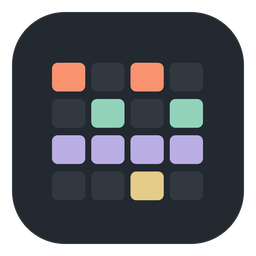
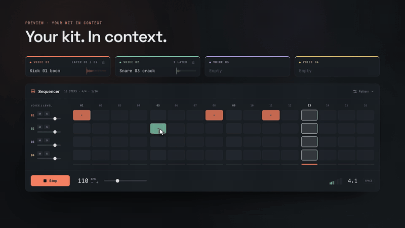
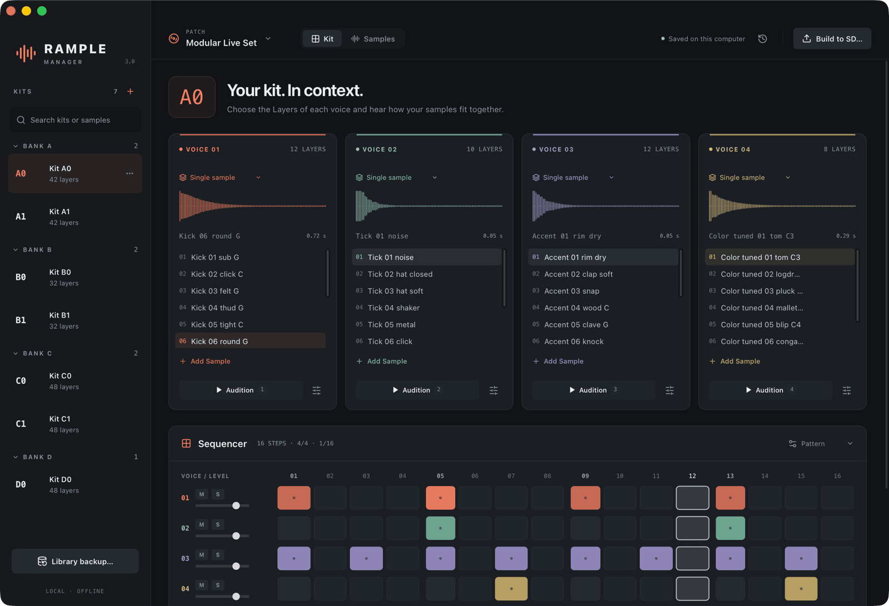

  

<h1 align="center">Rample Manager</h1>

  <b>Your samples. Your kits. Ready for the Rample.</b> 
  A free desktop app for macOS and Windows to organise your samples, build Kits for the
  Squarp Rample and Rample Turbo, hear them as the module will, and write the SD card safely.

  

  
  
  

   
  <a href="https://oliverlsanz.com/RampleManager/#tour"><b>▶ Watch the 50-second tour, with sound</b></a>

## Features

- **One sample Library.** Import WAV, AIFF, FLAC and MP3 files or whole folders; name, tag, search and
  audition every sound. Your originals are never modified.
- **Kits A0 to Z99.** Four Voices of up to 12 Layers per Kit. Drag samples onto voices, reorder Layers,
  duplicate and move Kits, with Undo for every deletion.
- **Hear your kit in context.** A sample-accurate 16-step sequencer plays the four voices together, so
  you hear how the sounds fit before anything goes to the SD card.
- **Sounds like the Rample.** Audition the exact mono 44.1 kHz preparation and all five Layer modes.
- **Non-destructive sample editor.** Trim, gain, varispeed pitch, EQ, echo and reverb over the complete
  original. Save for every use of a sound or as a new Variant, and change it later.
- **Import your card.** Bring an existing SD card into a Patch with its Kits, Layer order and the Layer
  modes you STOREd on the module.
- **Safe Build to SD.** Review every file before it is written. Replaced files are backed up and
  verified first, any Build can be restored, and `_save` is never touched.

Free, works offline, no account.

  

## Install

Download the newest installer from the
[latest release](https://github.com/OliverLSanz/rample-manager/releases/latest).

- **macOS 14+** (Apple Silicon and Intel): open `Rample-Manager-macOS.dmg` and drag **Rample Manager**
  to Applications. The app is not notarized, so the first launch is blocked: open **System Settings →
  Privacy & Security** and choose **Open Anyway**, or run
  `xattr -dr com.apple.quarantine "/Applications/Rample Manager.app"`.
- **Windows 10/11** (x64): run `Rample-Manager-Windows-x64-setup.exe`. It installs for the current user
  and adds the WebView2 runtime if it is missing. It is unsigned, so SmartScreen may ask: choose **More
  info → Run anyway**.

Installing a new version over the old one keeps your Library, Patches and settings. Step-by-step help
is in the [manual](https://oliverlsanz.com/RampleManager/manual/#install).

## Documentation

- [Manual](https://oliverlsanz.com/RampleManager/manual/): a visual guide to every screen.
- [How it works](docs/how-it-works.md): the detailed behavior of each feature.
- [Development](docs/development.md): build from source, architecture, tests and releases.
- [Release notes](docs/releases/) and [design decisions](docs/adr/).

Found a bug or have an idea? [Open an issue](https://github.com/OliverLSanz/rample-manager/issues).

---

Made by [Óliver L. Sanz](https://oliverlsanz.com/). Not affiliated with Squarp. Rample Manager was
called Rample Preview before version 3.0.
